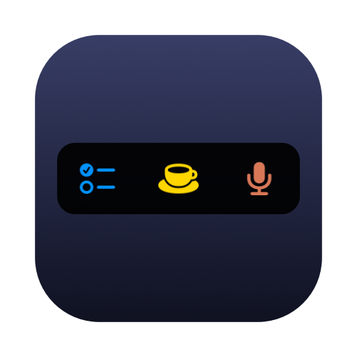
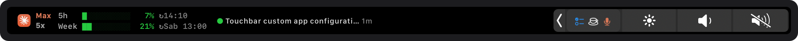

<p align="center"></p>

<h1 align="center">TouchDo for Claude</h1>

<p align="center">Limit Claude, sesi Claude Code yang lagi jalan, dan to-do, langsung di Touch Bar.<br>
<a href="README.md">English</a></p>



Nggak perlu bolak-balik buka jendela cuma buat ngecek sisa limit Claude. Semuanya ada di Touch Bar, sebelahan sama to-do.

## Isinya

- **Limit**: pemakaian 5 jam dan mingguan, plus kapan reset. Hijau, kuning mulai 50%, merah mulai 80%.
- **Sesi**: sesi Claude Code yang lagi kerja, dan sudah berapa lama. Sesi yang nunggu izin atau jawaban kamu jadi
  **kuning** dan pindah ke depan.
- **To-do**: tambah, centang, kasih deadline dari Touch Bar atau menu bar.
- **Pesawat kertas**: kirim to-do ke sesi Claude Code baru (masih eksperimen).
- **Mic**: tahan buat ngomong ke Claude, ketuk dua kali biar tetap nyala.
- **☕**: bikin Mac tetap nyala. Pakai [Insomnia](https://github.com/krishhgg/Insomnia) kalau ada.

Begitu kamu mulai ngetik, dia minggir dulu biar saran ketik tetap muncul. Sedetik setelah berhenti, dia balik lagi.

## Cara pasang

Butuh MacBook Pro dengan Touch Bar **dan tombol Esc fisik** (16 inci 2019, atau 13 inci 2020 ke atas), plus Xcode
command line tools (`xcode-select --install`).

```bash
git clone https://github.com/rasyachremony/touchdo-for-claude.git
cd touchdo-for-claude
./build.sh
```

Habis itu:

1. **System Settings → Privacy & Security → Accessibility**: nyalakan **TouchDo**. Ini buat tahu kapan kamu lagi ngetik.
2. **System Settings → Keyboard → Touch Bar Settings**: pilih **App Controls** dan nyalakan **Show Control Strip**.
3. Buat mic, set shortcut dikte di Claude ke **⌃⌥⌘D**.

Selesai. Tiap login dia nyala sendiri.

**Opsional:** tempel [statusline-usage.sh](statusline-usage.sh) ke
[script status line Claude Code](https://code.claude.com/docs/en/statusline) biar limitnya ke-update tiap balasan.

## Yang perlu kamu tahu

- **Pakai sedikit kuota plan kamu.** Kalau limit belum ke-update lima menit, TouchDo nanya Claude Code lewat satu
  permintaan kecil ke Haiku (sekitar 1.100 token). Kalau seharian lumayan juga, dan bisa memulai jendela 5 jam baru.
  Langkah opsional di atas bikin ini jauh lebih jarang. Buat matiin, ubah `autoRefresh` di `main.swift` jadi
  `.infinity` lalu jalankan `./build.sh` lagi.
- **Pesawat kertas beneran memulai sesi**, di folder dan mode izin yang lagi kepilih di Claude, termasuk file yang
  masih terlampir. Kalau pengirimannya nggak bisa dipastikan, dia bunyi dan teksnya dibiarkan buat kamu.
- **Data kamu tetap di Mac.** Selain permintaan kecil tadi, TouchDo nggak mengirim apa-apa. Dia cuma baca file Claude
  Code buat sesi dan plan, dan cuma baca ketikan waktu kamu lagi ngetik to-do.
- **Build-nya ditandatangani ad hoc**, jadi izin Accessibility terikat ke id aplikasinya. Aplikasi lain dengan id yang
  sama juga bakal dapat izin itu. Biar aman, tanda tangani pakai sertifikat sendiri dan hapus bagian `-r=...` di baris
  `codesign` di `build.sh`.
- **Pakai API privat Apple**, jadi update macOS bisa bikin rusak. Dites di macOS 27.
- **Bukan buatan Anthropic.** "Claude" itu merek dagang mereka.

## Ada masalah?

- **Bagian kiri kosong:** cek tombol Accessibility. Kalau sudah nyala, hapus TouchDo pakai **−** lalu tambah lagi.
- **Limit cuma "–":** login dulu di Claude Code, tunggu lima menit.
- **Mic diam aja:** buka Claude, tunggu sebentar, cek shortcut-nya.

## Hapus

```bash
./build.sh uninstall
```

To-do kamu tetap aman. Hapus juga TouchDo dari daftar Accessibility.

## Lisensi

[MIT](LICENSE)
