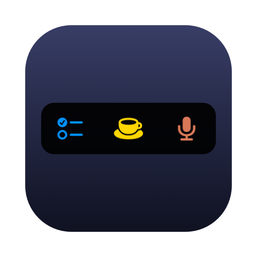

<p align="center"></p>

<h1 align="center">TouchDo for Claude</h1>

<p align="center">Your Claude limits, running Claude Code sessions and to-dos, right on the Touch Bar.<br>
<a href="README.id.md">Bahasa Indonesia</a></p>


No more switching windows to see how much of your Claude plan is left. It's just there, next to your to-dos.

## What you get

- **Your limits**: 5-hour and weekly use, plus the weekly Fable limit when your plan has one, with reset times.
  Green, yellow from 50%, red from 80%. They refresh every minute.
- **Token total**: a small line under your plan with every token Claude Code has used on this Mac, like "10.2B token".
- **Your sessions**: the Claude Code sessions working right now, and for how long, in a row you can swipe. Tap one
  to open it in the Claude app; it moves to the far left so you can see which one you opened. One that's waiting for your permission or answer turns **yellow** and moves to the
  front.
- **To-dos**: add, tick and set deadlines from the Touch Bar or the menu bar.
- **Trash**: deleted to-dos wait 30 days under **Sampah** in the menu bar, so you can bring them back.
- **Paper plane**: sends a to-do to a new Claude Code session (experimental).
- **Mic**: hold to talk to Claude, double tap to keep it on.
- **☕**: keeps your Mac awake. Uses [Insomnia](https://github.com/krishhgg/Insomnia) if you have it.

Start typing and it gets out of the way, so you still get typing suggestions. Two seconds after you stop, it's back.
The buttons are in Indonesian.

## Install

You need a MacBook Pro with a Touch Bar **and a real Esc key** (16-inch 2019, or 13-inch 2020 and later) and the Xcode
command line tools (`xcode-select --install`).

```bash
git clone https://github.com/rasyachremony/touchdo-for-claude.git
cd touchdo-for-claude
./build.sh
```

Then:

1. **System Settings → Privacy & Security → Accessibility**: turn on **TouchDo**. It needs this to know when you're typing.
2. **System Settings → Keyboard → Touch Bar Settings**: pick **App Controls** and turn on **Show Control Strip**.
3. For the mic, set Claude's dictation shortcut to **⌃⌥⌘D**.

That's it. It starts by itself every time you log in.

**Optional:** paste [statusline-usage.sh](statusline-usage.sh) into your
[Claude Code status line script](https://code.claude.com/docs/en/statusline) so the limits update after every reply
instead of every minute.

## Things you should know

- **The limits cost no tokens.** Every minute TouchDo runs Claude Code's own `/usage` command, which asks Anthropic for
  your limits without running a model. To change how often, set `autoRefresh` in `main.swift` and run `./build.sh`
  again.
- **The token total** comes from Claude Code's files in `~/.claude`. The first count after a start reads all your
  transcripts and can take half a minute; after that it only reads what's new.
- **The paper plane starts a real session**, in whatever folder and permission mode Claude has selected, with any files
  still attached there. If it can't confirm the send, it beeps and leaves the text for you.
- **Your data stays on your Mac.** Apart from the `/usage` check, TouchDo sends nothing anywhere. It reads Claude
  Code's own files for your sessions, plan and token total, and only reads what you type while you're typing a to-do.
- **The build is signed ad hoc**, so Accessibility is tied to the app's id. Another app signed with the same id would get
  it too. To avoid that, sign with your own certificate and drop the `-r=...` part of the `codesign` line in `build.sh`.
- **It uses private Apple APIs**, so a macOS update can break it. Tested on macOS 27.
- **Not made by Anthropic.** "Claude" is their trademark.

## Problems?

- **Nothing on the left:** check the Accessibility switch. If it's on, remove TouchDo with **−** and add it again.
- **Limits show "–":** sign in to Claude Code and wait a minute.
- **Mic does nothing:** open Claude, wait a few seconds, and check the shortcut.

## Uninstall

```bash
./build.sh uninstall
```

Your to-dos stay. Remove TouchDo from the Accessibility list too.

## License

[MIT](LICENSE)
